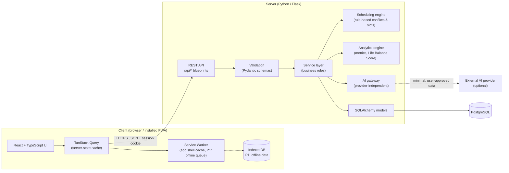
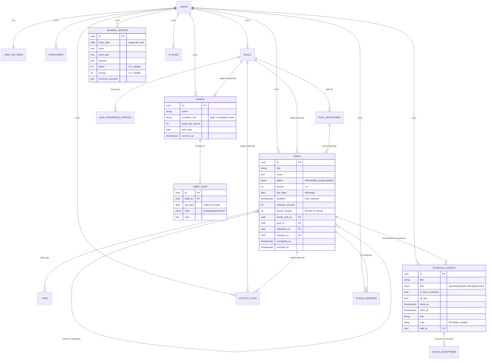
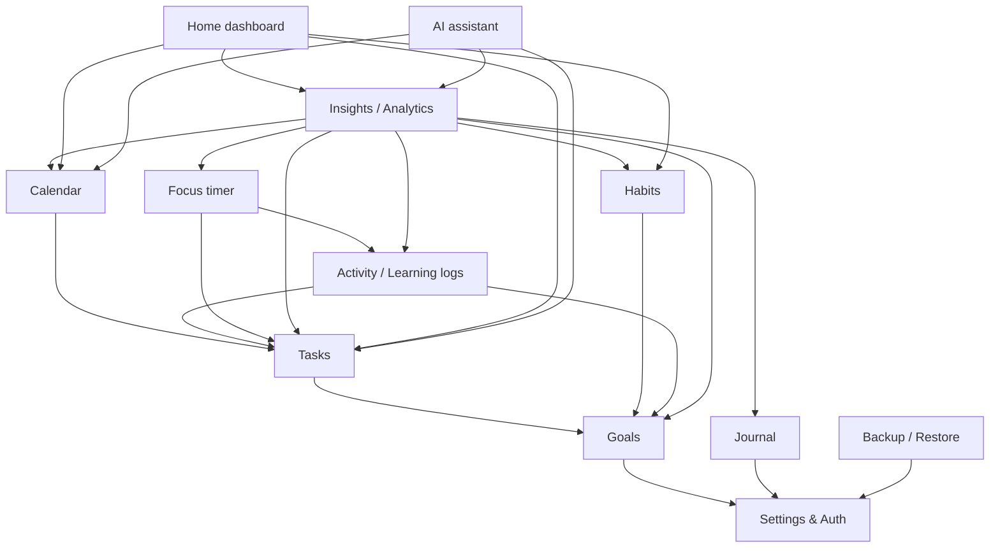
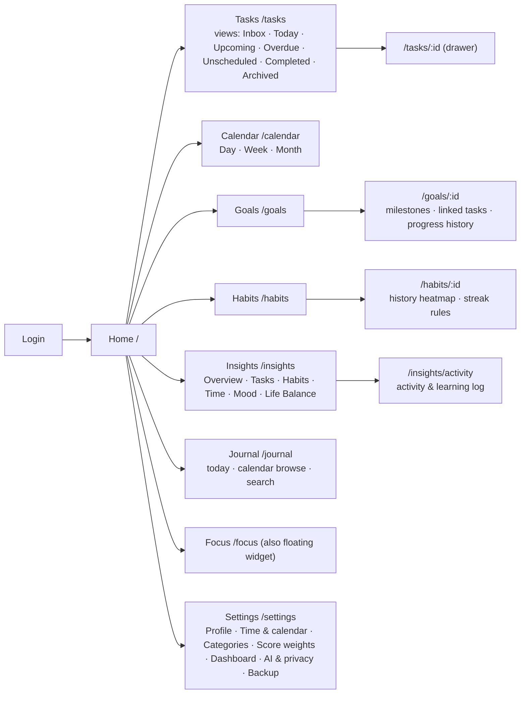

# Personal Life OS — Architecture & Initial Scope Plan

Status: **Approved 2026-10-20** (all assumptions A1–A15, with A4 and A12 amended below) · No application code has been written yet.

---

## 1. Product understanding

Personal Life OS is a single-user (for now) personal management system that closes the loop:

**Set Goals → Plan → Schedule → Execute → Record → Analyze → Reflect → Improve**

| Loop step | Module(s) that own it |
|---|---|
| Set goals | Goals & milestones |
| Plan | Tasks (inbox, priorities, estimates) |
| Schedule | Calendar (events, task time-blocks, conflict checks) |
| Execute | Focus timer, task status, habit check-ins |
| Record | Learning/activity logs, habit logs, actual durations |
| Analyze | Insights (metrics, Life Balance Score) |
| Reflect | Journal / daily review |
| Improve | Weekly review (manual first, AI-assisted later) |

Three things I am treating as non-negotiable because the spec repeats them:

1. **It works fully without AI.** AI only reads data and proposes; the user confirms every change.
2. **History is precious.** Archive, don't delete. No cascading deletes of personal records.
3. **Honesty in numbers.** Missing data ≠ zero. Every metric has a written formula and a data-coverage indicator.

---

## 2. Recommended system architecture

A classic **three-tier web app**, deployed as **one origin** (frontend and API served from the same domain). Same-origin matters: it removes CORS complexity and lets us use secure, httpOnly session cookies instead of storing tokens in JavaScript.



**Key layering rule (beginner note):** routes only parse requests and return responses; *services* hold the business rules (e.g., "completing a task updates goal progress"); *models* only describe tables. This keeps logic testable without a browser and reusable by a future desktop app.

---

## 3. Technology stack and reasons

| Layer | Choice | Why | Cost |
|---|---|---|---|
| Frontend framework | React 18 + TypeScript | Spec-mandated; strong typing catches bugs early | Free |
| Build tool | Vite | Fast dev server; first-class PWA plugin | Free |
| Styling | Tailwind CSS + CSS variables as design tokens | Consistent spacing/colors; easy light/dark theme | Free |
| Routing | React Router | Standard, well documented | Free |
| Server state | **TanStack Query** | Handles fetching, caching, loading/error states, retries; foundation for offline later. Avoids hand-rolled global stores | Free |
| UI-only state | React state/context (add Zustand only if needed) | Avoid unnecessary dependencies | Free |
| Forms + validation | React Hook Form + Zod | Typed forms; Zod schemas mirror backend validation | Free |
| Calendar | **FullCalendar (standard, MIT)** — daygrid, timegrid, list, interaction | Day/week/month + drag-and-drop are in the free edition. Premium is only needed for resource/timeline views, which we don't need | Free |
| Charts | Recharts | Simple React API, enough for our metrics | Free |
| Icons | Lucide | Clean, tree-shakeable | Free |
| PWA | vite-plugin-pwa (Workbox) | Manifest + service worker with explicit caching rules | Free |
| Backend | Python 3.12 + Flask (app factory + blueprints) | Spec-mandated; small and understandable | Free |
| Validation | **Pydantic v2** | Clear error messages, typed request/response schemas, easy OpenAPI generation | Free |
| ORM / migrations | SQLAlchemy 2.x + Alembic (via Flask-Migrate) | Spec-mandated; migrations are versioned and reversible | Free |
| Recurrence | RFC 5545 RRULE strings + `python-dateutil` | Industry-standard recurrence format (same as Google/Outlook); makes future calendar sync realistic | Free |
| Auth | Server-side session cookie (httpOnly, Secure, SameSite=Lax) + CSRF token; password hashed with Argon2 | Safest simple option for a same-origin web app | Free |
| Rate limiting | Flask-Limiter | Protects login and AI endpoints | Free |
| Database | PostgreSQL 16 | Spec-preferred; real constraints, `timestamptz`, JSON columns | Free locally |
| Tests | Pytest, Vitest + React Testing Library, Playwright | Spec-mandated | Free |
| CI | GitHub Actions | Free minutes for personal repos | Free (within quota) |

**Deliberate deviations / additions to the spec** (please approve):
- **TanStack Query, Zod, React Hook Form, Pydantic** are additions, not replacements. Each removes a large amount of hand-written, error-prone code.
- **UUID primary keys** instead of auto-increment integers. Reason: a PWA that queues offline changes needs the *client* to create IDs safely before the server sees them. Retrofitting this later is painful.
- **A `users` table and `user_id` on every record from day one**, even though there is one user. Adding it later means rewriting every query and migration; adding it now costs almost nothing. No sign-up page — the single account is created by a command-line script.

---

## 4. Initial database entity–relationship model

Conventions for every table: `id UUID PK`, `user_id FK → users`, `created_at`, `updated_at` (all `timestamptz`, stored in UTC). Archivable entities use `archived_at` instead of deletion. Foreign keys to history use `ON DELETE RESTRICT` or `SET NULL`, never `CASCADE` (except purely dependent rows such as a habit's schedule).



Tables shown in less detail (columns defined in the schema doc at Stage 1): `user_settings` (timezone, week start, working hours, score weights, dashboard layout, AI opt-in flags), `categories`, `tags`, `goal_milestones`, `goal_progress_updates`, `event_exceptions`, `activity_logs` (title, category, started_at, ended_at, duration_minutes, outcome), `focus_sessions` (planned_minutes, actual_minutes, state `completed|interrupted|abandoned`), `ai_runs` (type, prompt summary, what data categories were sent, response, created_at).

**Deliberately merged / deferred vs. the spec's list:**

| Spec table | Decision | Reason |
|---|---|---|
| `learning_logs` + `life_logs` | Merged into **`activity_logs`** with a category | Same shape; one table means one set of analytics queries |
| `task_goal_links` | Direct nullable FKs on `tasks` | A task belongs to at most one goal/milestone in practice; simpler. Revisit if many-to-many is needed |
| `habit_schedules` | Column on `habits` | One schedule per habit is enough for P0 |
| `daily_reviews` | Part of **`journal_entries`** | Same day, same purpose; avoids two places to write reflections |
| `task_dependencies`, `custom_metrics`, `notifications`, `audit` | **Deferred** (P1/P2) | No P0 feature needs them |

**Time rules (the biggest source of subtle bugs):**
- Instants (`starts_at`, `completed_at`) → `timestamptz` in UTC, displayed in the user's timezone.
- Calendar-day concepts (`due_date`, `log_date`, `entry_date`, all-day events) → plain `date`, interpreted in the user's timezone. A habit done at 23:30 counts for that local day.
- Recurring events store the RRULE + original timezone, and are expanded on read for the requested range. Edits to one occurrence go into `event_exceptions`.

---

## 5. Module boundaries and dependencies

Each module = one backend blueprint + service + frontend feature folder. Arrows mean "reads from / calls".



Rules:
- **Writes stay inside their module.** Calendar never edits a task's fields directly; it calls the Tasks service. AI never writes at all — it returns a *proposal* that the user applies through the normal module endpoints.
- **Analytics is read-only** and owns every formula in one place.
- **Dashboard has no data of its own** — it composes other modules.

---

## 6. Page and navigation map



| | Desktop (≥1024px) | Mobile (<768px) |
|---|---|---|
| Navigation | Collapsible left sidebar with all 8 sections | Bottom bar: Home · Tasks · Calendar · Habits · **More** (Goals, Insights, Journal, Focus, Settings) |
| Quick add | `Ctrl+K` command palette + "New" button | Floating **+** button → sheet: Task · Event · Habit check-in · Log activity · Journal · Mood |
| Calendar default | Week view with side panel of unscheduled tasks (drag onto calendar) | Day view / agenda list; tap to schedule |
| Detail editing | Side drawer, list stays visible | Full-screen sheet |
| Insights | Multi-chart grid | One chart per card, swipeable period |

Every page defines: loading skeleton, empty state with a single clear next action, error state with retry, and confirmation dialogs for archive/restore/apply-suggestion.

---

## 7. Development phases and acceptance criteria

I recommend one change to the spec's stage order: build a **thin vertical slice first** (Stage 1 ends with tasks working end-to-end, deployed-like, with tests). Seeing a real feature work through every layer early catches architecture mistakes while they're cheap.

| Stage | Scope | Acceptance criteria (must pass before moving on) |
|---|---|---|
| **0. Docs** | This plan → approved; schema doc; API conventions doc; design tokens | You approve scope & assumptions |
| **1. Foundation + Tasks slice** | Repo layout, Flask app factory, Postgres + Alembic, error format, auth (single user), React shell with responsive nav, theme, Tasks CRUD end-to-end, CI | `pytest` and `vitest` green in CI; login required for all `/api/*`; tasks survive server restart; migration runs on empty DB; app usable at 375px and 1440px |
| **2. Core data** | Goals, milestones, goal–task linking, subtasks, statuses, filters, search, archive/restore | Create/edit/complete/reopen/archive tasks; archived goal keeps its tasks & history; progress shows *source* (milestones / tasks / manual) |
| **3. Scheduling** | FullCalendar day/week/month, events, all-day, RRULE recurrence, task time-blocks, conflict detection, free-slot finder, suggestions with confirm | Overlap detected & explained; deadline-at-risk warning when unscheduled estimate > free time before deadline; **no event ever moves without an explicit confirm**; recurrence + single-occurrence edits correct across a DST change (tested) |
| **4. Personal tracking** | Habits + logs + streaks, activity logs, journal/daily review, focus timer | Streak rules documented & unit-tested (scheduled days only; "skipped" doesn't break, "missed" does); durations correct; past entries editable; journal never appears in server logs |
| **5. Insights** | Dashboard, metrics, Life Balance Score v0, coverage indicators, trends | Every metric has a written formula in-app; missing data shown as "no data", not 0; score shows components, weights, coverage %; chart values match a SQL check in tests |
| **6. Backup** *(moved earlier than spec)* | JSON export of all user data; validated restore into an empty account or as a dry-run diff | Export → wipe test DB → restore → record counts and checksums identical; restore never overwrites without confirmation |
| **7. AI (P1)** | Provider-independent gateway; daily plan; weekly review; privacy controls | Works with no API key (feature hidden + explanation); every AI request shows which data categories will be sent; journal text excluded unless explicitly toggled per request; all suggestions applied only via confirm |
| **8. PWA & offline (P1)** | Manifest, icons, service worker, app-shell cache; offline read of today's view; offline queue for task-complete / habit check-in / quick capture | Installable on Chrome (desktop + Android) and Safari iOS; airplane-mode test of the listed flows; replay after reconnect with no duplicates (idempotency keys); offline limits shown in UI |
| **9. Quality & deploy** | Playwright E2E for key flows, accessibility pass (axe), security review, perf budget, production deploy, docs | E2E green; no critical axe issues; secrets scan clean; production DB backups configured *and a restore tested* |

Why backup moved to Stage 6: you'll be entering real personal data from Stage 2 onward; a tested export should exist before AI and PWA work.

**Life Balance Score v0 (proposal):**

| Component | Default weight | v0 formula (period = last 7 days) | Counts as "no data" when |
|---|---|---|---|
| Task execution | 30% | done-on-time ÷ tasks due in period (tasks without due dates excluded) | 0 tasks due |
| Goals & learning | 25% | 50% milestone/goal progress delta vs. plan + 50% learning minutes ÷ user's weekly target | no active goals *and* no target set |
| Habits & routines | 30% | completed ÷ scheduled habit-days (skipped days excluded from both) | 0 scheduled habit-days |
| Wellbeing (self-report) | 15% | mean(mood, energy) rescaled 1–5 → 0–100 | < 3 check-ins in period |

Components with no data are **removed and remaining weights renormalised**; the UI shows "Score based on 3 of 4 components, 62% data coverage". No double counting: a habit check-in never also counts as a task. Labelled "experimental", no health/psychological claims.

---

## 8. Major technical risks and mitigations

| # | Risk | Impact | Mitigation |
|---|---|---|---|
| 1 | **Scope** — P0 alone is ~10 modules for one learning developer | Never ships | Vertical slices; each stage usable on its own; strict P0/P1/P2; I'll flag scope creep |
| 2 | **Time zones & DST** | Wrong days for habits/streaks, events shifting by an hour | Rules in §4; all date logic in one backend module with dedicated tests incl. DST dates |
| 3 | **Recurring events** | Edge cases (edit one vs. all, exceptions) are notoriously hard | Use RRULE + dateutil rather than custom logic; P0 supports "this occurrence" and "all"; "this and following" deferred |
| 4 | **Offline sync conflicts** | Duplicate or lost edits | Offline writes limited to a few safe, append-like actions; client UUIDs + idempotency keys; last-write-wins with `updated_at` check and visible conflict notice |
| 5 | **Private data exposed when deployed** | Journal leakage | Auth on every endpoint from Stage 1; HTTPS only; no journal text in logs; AI data minimisation; security checklist in Stage 9 |
| 6 | **Data loss** | Irreversible | No cascades, archive-first, export in Stage 6, managed DB backups, *tested* restore |
| 7 | **Free-tier hosting changes or sleeps** | App unavailable, DB deleted | Keep deploy portable (Docker image + env vars); don't rely on a free DB that expires; documented migration path |
| 8 | **Misleading analytics** | Bad decisions | Formulas documented in-app, coverage indicators, tests compare charts to raw SQL |
| 9 | **AI cost or provider lock-in** | Surprise bills | Provider interface, per-month token budget setting, small default model, AI off by default |
| 10 | **Learning curve** (React + Flask + SQL + PWA at once) | Frustration, fragile code | I explain each new concept as it's introduced; conventions doc; small PRs; tests as living examples |

---

## 9. Expected costs

| Item | Free option | Paid option (if/when needed) | Notes |
|---|---|---|---|
| All libraries & tools | ✅ Everything in §3 is open-source | — | FullCalendar premium **not** needed |
| Local development | ✅ Your laptop + PostgreSQL (installer or Docker Desktop) | — | Docker Desktop is free for personal use |
| Source control + CI | ✅ GitHub private repo + Actions free quota | — | |
| App hosting | Free tiers (e.g., Render, Fly.io, Railway trial) — often sleep when idle | ~US$5–7/month for an always-on small instance or VPS | Free tiers change frequently — I'll verify current terms at deploy time |
| PostgreSQL hosting | Free tiers (e.g., Neon, Supabase) — size-limited | ~US$0–25/month depending on provider and backups | Must confirm backups/retention on whichever is chosen |
| Domain name | Use the host's subdomain | ~US$10–15/year | Optional |
| AI provider | — | Pay-per-use; for one person doing a daily plan + weekly review on a small model, expect **roughly a few US$/month**; set a hard budget cap | Off by default; app works without it |
| Email/push services | Not needed in P0 | — | In-app reminders first |

**Realistic total:** US$0/month while developing; ~US$5–15/month once deployed with reliable hosting and modest AI use.

---

## 10. Desktop, mobile and PWA strategy

1. **Now — responsive web app.** Designed mobile-first for quick actions, desktop-dense for planning. Tested at 375, 768, 1024, 1440px.
2. **P1 — PWA.** Installable; app shell cached; **only** today's tasks/habits/events cached for offline reading; journal content is **not** cached offline by default (privacy); offline write queue for 3–4 safe actions. Honest offline banner listing what works.
3. **P2 — Desktop app with Tauri** (recommended over Electron: much smaller binaries and memory use; uses the system web view). Reuses the same React build; talks to the same API. Adds native notifications, tray, global shortcut. Kept possible today by: no browser-only assumptions in business logic, API base URL from config, auth that can switch to token-based for the desktop client.
4. **P2+ — Native mobile** only if PWA limits actually hurt (mainly iOS background notifications). Capacitor would let us wrap the same React code before considering a full native rewrite.

---

## 11. Proposed project structure (preview only — not created yet)

```
life-os/
├─ backend/
│  ├─ app/
│  │  ├─ __init__.py          # app factory
│  │  ├─ config.py            # dev/test/prod configs from env vars
│  │  ├─ extensions.py        # db, migrate, limiter
│  │  ├─ common/              # errors, auth, time utilities, pagination
│  │  └─ modules/
│  │     ├─ tasks/            # routes.py · schemas.py · service.py · models.py
│  │     ├─ goals/  calendar/  habits/  activity/  journal/
│  │     ├─ analytics/  ai/  settings/  backup/
│  ├─ migrations/
│  ├─ tests/
│  └─ pyproject.toml
├─ frontend/
│  ├─ src/
│  │  ├─ app/                 # router, providers, layout shell
│  │  ├─ components/ui/       # buttons, inputs, dialogs (design system)
│  │  ├─ features/            # tasks/, calendar/, goals/ ... (pages + hooks + api)
│  │  ├─ lib/                 # api client, date utils
│  │  └─ styles/tokens.css
│  ├─ tests/ e2e/
│  └─ package.json
├─ docs/                      # this plan + the 18 deliverables over time
├─ .env.example               # documented, no real secrets
└─ .github/workflows/ci.yml
```

---

## 12. Assumptions that need your approval

| # | Assumption / default | Alternatives |
|---|---|---|
| A1 | Stack exactly as §3, including the additions (TanStack Query, Zod, React Hook Form, Pydantic, UUID keys) | Drop any addition |
| A2 | **PostgreSQL in local development too** (via installer or Docker Desktop) — avoids SQLite/Postgres differences | SQLite locally, Postgres in CI/prod |
| A3 | Single user, but `users` table + login from Stage 1; account created by CLI, no sign-up page | No login until deployment (risky) |
| A4 | ✅ Timezone: one user timezone in settings, default **Asia/Kuala_Lumpur** (UTC+8, no DST); week starts Monday | Sunday start; per-event zones only |
| A5 | Task statuses: Inbox · To Do · In Progress · Done, plus **Archived as a flag** (`archived_at`), so an archived task remembers whether it was done | Archived as a status |
| A6 | Learning and life activities share one `activity_logs` table; daily review lives inside journal entries | Separate tables |
| A7 | Recurrence in P0: events and habits; **tasks do not recur in P0** | Recurring tasks in P0 |
| A8 | Habit streak rules: count scheduled days only; "skipped" (intentional rest) pauses, "missed" breaks; also show a 30-day consistency % so one miss isn't a "failure" | Other rules |
| A9 | Life Balance Score v0 as in §7, labelled experimental | Change weights/formulas |
| A10 | Backup = JSON export/import (CSV export for tasks/activity as a convenience) in Stage 6 | Different format/timing |
| A11 | AI deferred to Stage 7, off by default, journal never sent unless toggled per request; provider: Anthropic Claude first behind a generic interface | Other provider / earlier |
| A12 | ✅ **Amended:** UI in **English and Simplified Chinese** (switchable in Settings, stored per user); light + dark themes. i18n built in from Stage 1 — see `03-design-and-i18n.md` | — |
| A13 | Deployment target decided at Stage 9, aiming for ~US$5–15/month; free tier acceptable during development | Strict US$0 |
| A14 | Desktop app later via **Tauri**, not Electron | Electron |
| A15 | Git repository initialised in this folder with GitHub as remote (private) | Local-only git |

**Environment check (2026-10-20):** Python 3.14.3 ✅ · Node.js 22.23 ✅ · npm 10.9 ✅ · Git 2.55 ✅ · PostgreSQL ❌ not installed. The folder is not yet a git repository. Python 3.14 replaces the 3.12 mentioned in §3; we'll pin it in `pyproject.toml`.

**Open question:**
- PostgreSQL is missing (Docker Desktop is also not installed). Should you install Docker Desktop (recommended: one command starts/stops the DB, easy to reset) or the native PostgreSQL Windows installer?

Once you approve (or edit) this list, Stage 0 continues with the schema doc and API conventions, then Stage 1 implementation.
